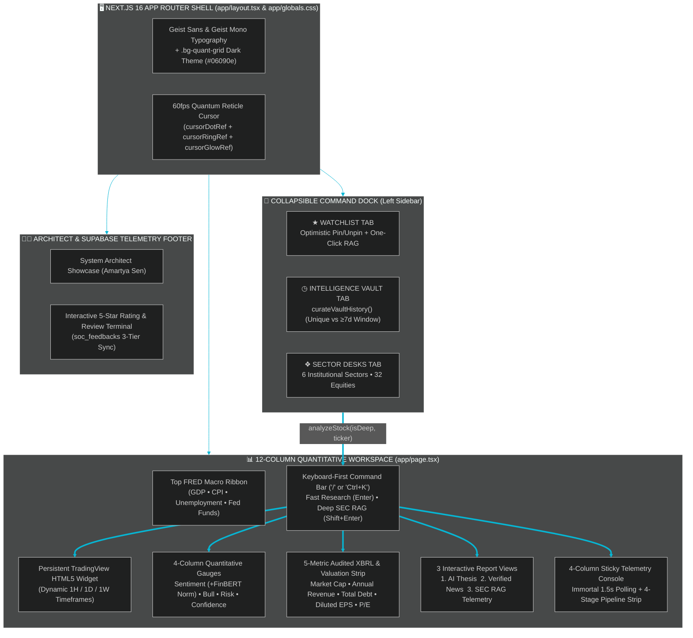
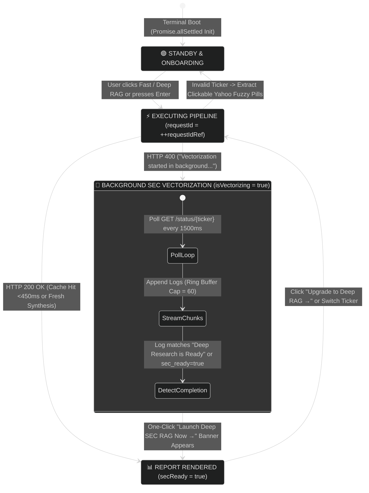
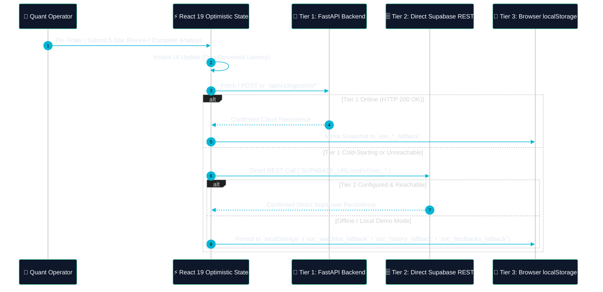

<div align="center">

<!-- ANIMATED HERO WAVE BANNER -->


<!-- ANIMATED TYPING TELEMETRY SVG -->
<a href="https://socrates-frontend.vercel.app">
  
</a>

<br />

<!-- TECH STACK & DEPLOYMENT BADGES -->
<p align="center">
  <a href="https://socrates-frontend.vercel.app"></a>
  
  
  
  
  
  
</p>

<!-- QUICK NAVIGATION BAR -->
<p align="center">
  <a href="#-executive-ux--performance-scorecard"><kbd>📊 UX Scorecard</kbd></a> •
  <a href="#️-visual-workstation-blueprint"><kbd>🖥️ Terminal Blueprint</kbd></a> •
  <a href="#-client-architecture--data-flow"><kbd>🧬 Client Architecture</kbd></a> •
  <a href="#-immortal-telemetry--non-blocking-rag-state-machine"><kbd>⚡ Immortal Polling</kbd></a> •
  <a href="#-3-tier-resilient-persistence-cascade"><kbd>🛡️ 3-Tier Persistence</kbd></a> •
  <a href="#-institutional-sector-desks-32-equities"><kbd>🏦 6 Sector Desks</kbd></a> •
  <a href="#-quick-start--local-development"><kbd>🚀 Quick Start</kbd></a>
</p>

</div>

---

## 📊 Executive UX & Performance Scorecard

<table>
  <tr>
    <td align="center" width="25%">
      <br />
      <sub><b>Immortal Polling Engine</b><br />Capped ring buffer (`MAX_LOGS = 60`) + monotonic `requestIdRef` concurrency guard</sub>
    </td>
    <td align="center" width="25%">
      <br />
      <sub><b>GPU-Accelerated Reticle</b><br />Zero-re-render `requestAnimationFrame` `translate3d` interpolation (`0.22` lerp)</sub>
    </td>
    <td align="center" width="25%">
      <br />
      <sub><b>6 Institutional Desks</b><br />1-click analysis across US Mega-Caps, Semis, Wall St, Defense &amp; `20-F` ADRs</sub>
    </td>
    <td align="center" width="25%">
      <br />
      <sub><b>Zero-Data-Loss State</b><br />FastAPI Primary → Direct Supabase REST → `localStorage` Optimistic Sync</sub>
    </td>
  </tr>
</table>

---

## 🖥️ Visual Workstation Blueprint

The entire interface in [`app/page.tsx`](file:///C:/Users/Amart/Desktop/Projects/socrates-frontend/app/page.tsx) is engineered as a **zero-page-reload, single-screen institutional workstation** modeled after a Bloomberg Terminal:

```text
┌───────────────────┬──────────────────────────────────────────────────────────────────────────────────┐
│ 🏛️ SOCRATES v3.0  │ ● US MACRO (FRED):  GDP: $29.35T  │  CPI INDEX: 314.12 pts  │  FED FUNDS: 4.83% ↻ │
│ Quant RAG Terminal├──────────────────────────────────────────────────────────────────────────────────┤
├───────────────────┤ [AUTONOMOUS MULTI-AGENT EQUITY INTELLIGENCE]                                     │
│ [WATCH][VAULT][6] │ Socrates Research Engine        [$ NVDA        /] [⚡ FAST] [🔬 DEEP RAG] [★ PIN] │
├───────────────────┼───────────────────────────────────────────────────────┬──────────────────────────┤
│ ★ TRACKED ASSETS  │ 📈 $NVDA LIVE TRADINGVIEW CHART          [1H][1D][1W] │ ●●● TELEMETRY: $NVDA     │
│ ● SEC RSS Live    │ ┌───────────────────────────────────────────────────┐ │ [● LIVE]     [AUTO][CLR] │
│ ┌───────────────┐ │ │  Candlesticks + Volume + Technical Overlays       │ ├──────────────────────────┤
│ │ $NVDA   [88]  │ │ │  (Persistent HTML5 iframe — zero unmount churn)   │ │ 1.XBRL 2.NEWS 3.RAG 4.AI │
│ │ $MSFT   [82]  │ │ └───────────────────────────────────────────────────┘ ├──────────────────────────┤
│ │ $AAPL   [76]  │ ├───────────────────────────────────────────────────────┤ 01 > Validating equity...│
│ └───────────────┘ │ 🧠 $NVDA Intelligence Report       [🔬 DEEP SEC RAG]  │ 02 > SEC XBRL Success.   │
│                   │ ┌────────────┬────────────┬────────────┬────────────┐ │ 03 > FMP Valuation OK.   │
│ ◷ VAULT CURATION  │ │ SENTIMENT  │ BULL SCORE │ INST. RISK │ CONFIDENCE │ │ 04 > 15 Benzinga News.   │
│ [UNIQUE] [≥7D]    │ │ BULLISH 88 │   91/100   │   28/100   │    94%     │ │ 05 > 3-Query Cohere v3   │
│                   │ │ Norm +0.76 │ █████████░ │ ███░░░░░░░ │ █████████░ │ │ 06 > Groq Llama-3.3 70B  │
│ ❖ 6 SECTOR DESKS  │ └────────────┴────────────┴────────────┴────────────┘ │ 07 > Report Ready! ▊     │
│ • AI & Semis (6)  │ ┌───────────────────────────────────────────────────┐ ├──────────────────────────┤
│ • Hyperscale (6)  │ │ MKT CAP: $3.42T │ REV: $130.5B │ EPS: $2.94 │ P/E │ │ ✓ NVDA SEC Vectors Ready │
│ • Wall St (6)     │ └───────────────────────────────────────────────────┘ │         [Run Deep RAG →] │
│ • Cyber/Def (4)   │ [AI INSTITUTIONAL THESIS] [NEWS (15)] [SEC TELEMETRY] └──────────────────────────┘
│ • BioPharma (4)   │ ┌─────────────────────────┬─────────────────────────┐                            │
│ • Global ADRs (6) │ │ ▲ INSTITUTIONAL BULL    │ ▼ INSTITUTIONAL BEAR    │                            │
├───────────────────┤ │   Catalysts & Margins   │   Structural Headwinds  │                            │
│ ⚡ OmniStock AI ↗ │ └─────────────────────────┴─────────────────────────┘                            │
└───────────────────┴──────────────────────────────────────────────────────────────────────────────────┘
```

---

## 🧬 Client Architecture & Data Flow



---

## ⚡ Immortal Telemetry & Non-Blocking RAG State Machine

Standard loading spinners hide backend complexity and break when a `10-K` or `20-F` filing requires 30+ seconds of background vectorization. [`app/page.tsx`](file:///C:/Users/Amart/Desktop/Projects/socrates-frontend/app/page.tsx) implements an **Immortal Polling & Concurrency State Machine**:



### Key Frontend Engineering Guards
* **Race-Condition Immunity (`requestIdRef`)**: Every `analyzeStock()` and `loadHistoryReport()` call increments a monotonic `requestIdRef`. If a user rapidly switches from `$NVDA` to `$MSFT`, stale network responses from `$NVDA` are immediately discarded before mutating state.
* **Sub-Second Cache-Hit Synchronization**: When the backend Tier-1 Cache Barrier resolves in `<450ms`, `analyzeStock()` forces an immediate synchronous `await fetchLatestLogs(targetTicker)` prior to unmounting the polling interval so the terminal always displays the full execution trail.
* **Smart Error Recovery & Fuzzy Ticker Pills (`extractSuggestionTickers`)**: If a user enters a company name or typo (e.g., `GOOGLE` or `TESLA`), the UI parses Yahoo Finance suggestions from the backend error payload and renders **1-click interactive ticker recovery pills**.

---

## 🛡️ 3-Tier Resilient Persistence Cascade

To ensure the terminal remains 100% interactive even during cold-starts or offline testing, Watchlist (`soc_watchlist`), Intelligence Vault (`soc_research_intelligence`), and Community Ratings (`soc_feedbacks`) operate on a **3-Tier Persistence Cascade**:



---

## 🏦 Institutional Sector Desks (32 Equities)

The left command dock includes **6 pre-configured Institutional Sector Desks** (`PRESET_SECTORS`) for instant 1-click coverage across US GAAP (`10-K`) and Foreign Private Issuer IFRS (`20-F`) equities:

| Sector Desk | Covered Equities (`10-K` & `20-F`) | Primary Research Focus |
| :--- | :--- | :--- |
| **1. AI & Semiconductors** | `$NVDA` • `$AMD` • `$AVGO` • `$TSM` • `$ASML` • `$ARM` | Wafer foundry capacity, custom ASICs, AI capex cycles |
| **2. Hyperscale Cloud & Big Tech** | `$MSFT` • `$AAPL` • `$GOOG` • `$AMZN` • `$META` • `$ORCL` | Cloud backlog, AI infrastructure capex, operating margins |
| **3. Wall Street & FinTech** | `$JPM` • `$GS` • `$V` • `$MA` • `$BLK` • `$COIN` | Net interest income, AUM flows, payment rail volumes |
| **4. Cybersecurity & Defense AI** | `$PLTR` • `$PANW` • `$CRWD` • `$LMT` | Sovereign defense contracts, ARR net retention, zero-trust |
| **5. Healthcare & BioPharma** | `$LLY` • `$UNH` • `$NVO` • `$ISRG` | GLP-1 pipeline, surgical robotics, FDA clinical catalysts |
| **6. Global ADRs & Consumer** | `$TSLA` • `$SAP` *(20-F)* • `$INFY` *(20-F)* • `$WIT` *(20-F)* • `$WMT` • `$COST` | Cross-border IFRS `20-F` accounting, EV margins, retail scale |

---

## 🎨 Signature UI/UX Micro-Interactions

<table>
  <tr>
    <td width="50%" valign="top">
      <h4>🎯 60fps Quantum Reticle Cursor</h4>
      <ul>
        <li>Implemented in <a href="file:///C:/Users/Amart/Desktop/Projects/socrates-frontend/app/page.tsx"><code>app/page.tsx</code></a> &amp; <a href="file:///C:/Users/Amart/Desktop/Projects/socrates-frontend/app/globals.css"><code>app/globals.css</code></a> exclusively for desktop fine pointers (<code>(pointer: fine)</code>).</li>
        <li>Uses 3 independent DOM refs (<code>cursorDotRef</code>, <code>cursorRingRef</code>, <code>cursorGlowRef</code>) updated via <code>requestAnimationFrame</code> with a <code>0.22</code> linear interpolation factor.</li>
        <li>Automatically morphs into a glowing cyan lock-on ring when hovering interactive buttons, inputs, or ticker cards.</li>
      </ul>
    </td>
    <td width="50%" valign="top">
      <h4>📋 1-Click Executive Markdown Brief Export</h4>
      <ul>
        <li><code>handleCopyReport()</code> synthesizes the active report into a clean, structured Markdown brief for investment memos.</li>
        <li>Includes the computed <b>FinBERT Normalized Score</b>:
          <br /><code>FinBERT_Norm = (sentiment_score / 50) - 1</code> (ranging from <code>-1.00</code> to <code>+1.00</code>).</li>
        <li>Seamless cross-link to the companion <b>OmniStock AI Price Action Predictor</b>.</li>
      </ul>
    </td>
  </tr>
</table>

---

## 📂 Repository Blueprint

```text
socrates-frontend/
├── app/
│   ├── layout.tsx                   # Root HTML shell, Geist Sans & Geist Mono fonts, SEO metadata
│   ├── globals.css                  # Tailwind CSS v4 @theme config, .bg-quant-grid, custom cursor & scrollbars
│   ├── page.tsx                     # Complete 2,894-line Institutional Research Terminal client application
│   ├── LinkedIn_Pfp.jpg             # System Architect portrait asset rendered via next/image
│   └── favicon.ico                  # Terminal crest icon
├── public/                          # Static SVG assets
├── next.config.ts                   # Next.js 16 TypeScript configuration
├── postcss.config.mjs               # Tailwind v4 @tailwindcss/postcss pipeline
├── eslint.config.mjs                # ESLint 9 flat configuration
├── tsconfig.json                    # Strict TypeScript 5 configuration
└── package.json                     # Next.js 16.2.9, React 19.2.4, Tailwind CSS v4 dependencies
```

---

## 🚀 Quick Start & Local Development

### 1. Configure Environment Variables (Optional)
By default, the terminal connects directly to the production Socrates Cloud Engine (`https://socrates-backend-kbyq.onrender.com`). To point to a local backend or enable Tier-2 direct Supabase REST fallback, create `.env.local`:

```ini
# Point to local FastAPI engine (defaults to Render production URL if omitted)
NEXT_PUBLIC_API_BASE_URL="http://localhost:8000"

# Optional Tier-2 Direct Supabase REST Fallback for soc_feedbacks
NEXT_PUBLIC_SUPABASE_URL="https://your-project.supabase.co"
NEXT_PUBLIC_SUPABASE_ANON_KEY="your-supabase-anon-key"
```

### 2. Install & Boot the Terminal

```bash
# Install dependencies
npm install

# Start the Next.js 16 development server
npm run dev
```

Open **[http://localhost:3000](http://localhost:3000)** in your browser and press <kbd>/</kbd> or <kbd>Ctrl</kbd>+<kbd>K</kbd> to initiate a quantitative research uplink.

---

<div align="center">

### 👨‍💻 System Architect & Creator

**Amartya Sen**  
*B.Tech in Computer Science & Engineering (Artificial Intelligence & Machine Learning)*  
Architecting fault-tolerant, autonomous AI systems at the intersection of quantitative finance and deep learning.

<p align="center">
  <a href="https://www.linkedin.com/in/amartya-sen"></a>
  <a href="https://github.com/AmartyaSen23"></a>
  <a href="https://omnistock-ai.streamlit.app/"></a>
</p>


</div>
